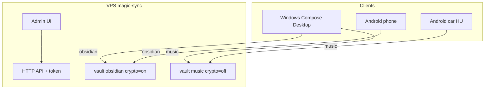

# MAGIC: мульти-vault, crypto on/off, Android + Windows Desktop + Server UI

## Целевая модель

Один процесс сервера, один `MAGIC_SYNC_TOKEN`, много vault’ов с изолированными данными:
`/opt/magic-sync/data/<vaultId>/{index.json,meta.json,access.log,blobs/}`.

## Решения (зафиксировано)

- **Изоляция vault’ов**: path prefix API `/v1/vaults/{vaultId}/...`, не отдельные порты.
- **Crypto**: настройка на vault (`aes-gcm` | `none`). Режим пишется в pointer/index и проверяется клиентами; смешивать режимы в одном vaultId нельзя.
- **Клиенты**: Android (телефон + авто) и Windows Compose Desktop на общем `sync-core` (+ по возможности общий UI-модуль профилей).
- **Windows**: tray-приложение, автостарт с Windows, планировщик синка per-vault (интервал в минутах).
- **Server Admin UI**: встроенная веб-панель на том же процессе (отдельный path `/admin`, тот же token или `MAGIC_ADMIN_TOKEN`).

## Профиль vault на клиенте

Локальный конфиг (JSON), список профилей:

- `id` (совпадает с `vaultId` на сервере)
- `name` (Obsidian / Music)
- `localPath`
- `server`, `token`
- `device` (X15B / s24u / car)
- `crypto`: `aes-gcm` | `none`
- `keyPath` (только для `aes-gcm`)
- `scheduleMinutes` (0 = только вручную; Windows)
- `enabled`

QR setup расширяется: `MAGIC-SETUP-1` + JSON с `vaultId`, `crypto`, `server`, `token`, `device` (ключ по-прежнему не в QR).

## Force-push (сервер → клиенты)

В `meta.json` vault’а:

- `forceEpoch` (монотонный int; 0 = выкл)
- при включении в Admin UI epoch++

В `IndexPointer` (GET index) отдаётся `forceEpoch`.

Клиентский `SyncEngine`:

1. Хранит локально `lastSeenForceEpoch`.
2. Если `pointer.forceEpoch > lastSeenForceEpoch` — режим **force-pull**: локальные изменения не пушатся; локальное дерево приводится к серверному индексу (скачать недостающее, удалить лишнее на диске, state = server revision/epoch).
3. После успеха записать `lastSeenForceEpoch`.
4. В UI/логе явная строка: «Сервер требует force-pull (epoch N)».

Так админ может «сделать сервер эталоном» после поломки клиента или ошибочного массового изменения.

## Изменения по модулям

### 1. `sync-core` — ядро

Файлы: [`sync-core/src/main/kotlin/com/alexskoropletov/sync/`](sync-core/src/main/kotlin/com/alexskoropletov/sync/)

- `CryptoMode` + слой `BlobCodec` (`encrypt/decrypt` или passthrough).
- `IndexPointer` / модель: поля `crypto` (default `aes-gcm`) и `forceEpoch` (default 0).
- `SyncEngine`: codec + ветка force-pull; при crypto mismatch — явная ошибка.
- `HttpRemote`: базовый URL с `vaultId` (`.../v1/vaults/{id}`).
- `SetupCard` / `SetupQr`: поля `vaultId`, `crypto`.
- Профиль-конфиг: `VaultProfile` + load/save helpers.

Обратная совместимость: старый `/v1/index` без vaultId → vault `default`.

### 2. Server CLI — [`sync-cli/.../Server.kt`](sync-cli/src/main/kotlin/com/alexskoropletov/sync/cli/Server.kt)

- Роуты: `/v1/vaults/{vaultId}/index`, `/v1/vaults/{vaultId}/blobs/{id}`.
- Данные: `dataDir / vaultId / {index.json, meta.json, access.log, blobs/}`.
- Валидация `vaultId`.
- Legacy aliases `/v1/index`, `/v1/blobs/` → `default`.
- Access log: append-only строки `ts method path status bytes peer` (ротация по размеру, напр. 5 МБ).
- Admin API (под тем же процессом):
  - `GET /admin/api/vaults` — список vaultId, revision, crypto, forceEpoch, sizeBytes, blobCount
  - `POST /admin/api/vaults/{id}/force-push` — bump `forceEpoch`
  - `DELETE /admin/api/vaults/{id}/force-push` — сброс epoch в 0 (опционально) или отдельный clear
  - `GET /admin/api/vaults/{id}/stats` — детали + хвост access.log
- Auth admin: `Authorization: Bearer` с `MAGIC_ADMIN_TOKEN` (если не задан — тот же sync token).

### 3. Server Admin UI

- Статика, раздаваемая из jar (`/admin/`): простая одностраничная панель (без тяжёлого SPA-фреймворка; vanilla JS или минимальный Compose/HTML).
- Экраны:
  - **Список vault’ов**: id, revision, crypto, размер, force-push on/off.
  - **Карточка vault**: кнопка «Force push» (подтверждение), статистика (revision, blob count, size), последние N записей access log.
- Доступ по сети только с token; на VPS рекомендуется не светить `/admin` в интернет без VPN/firewall (как и sync API).

### 4. Android app — [`app/`](app/)

- Список vault-профилей вместо одного набора prefs.
- Экран: список → детали → Sync + live log.
- QR добавляет/обновляет профиль (`vaultId`, `crypto`).
- Ключ per-vault: `sync-<vaultId>.key`.
- Тот же APK для телефона и авто HU; `device` в профиле (`s24u` / `car`).
- Показ и выполнение force-pull.

### 5. Windows Desktop — новый модуль `desktop/`

- Compose Desktop + `sync-core`.
- UI профилей: папка, crypto, ключ, interval, Sync Now, live log.
- Фон: schedule per enabled profile.
- Автостарт + system tray.
- Сборка в `dist/MAGIC-windows.zip`.
- CLI scripts остаются thin wrapper для отладки.
- Honor force-pull.

### 6. Деплой / dist

- [`deploy/`](deploy/): новый jar; миграция `data/*` → `data/default/` при первом старте.
- `dist/README.md`: Obsidian (crypto on) / Music (crypto off) / Admin UI URL.

## Порядок реализации

1. Core: crypto + vaultId + forceEpoch/force-pull + тесты.
2. Server multi-vault + meta/access log + legacy default + миграция.
3. Admin API + Admin UI (список, force-push, stats/logs).
4. Android multi-profile.
5. Desktop Compose: UI, schedule, tray, autostart.
6. Dist + staging deploy + прогон Obsidian/Music/admin.

## Вне скоупа этой волны

- End-to-end шифрование имён путей в plain-режиме.
- Отдельный авто-only APK / Android Auto media browser.
- Per-vault ACL (разные токены на vault) — позже.
- GC неиспользуемых blob’ов на сервере — отдельной задачей.
